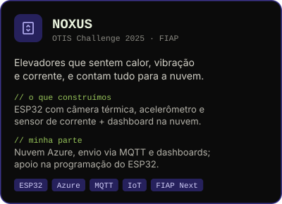
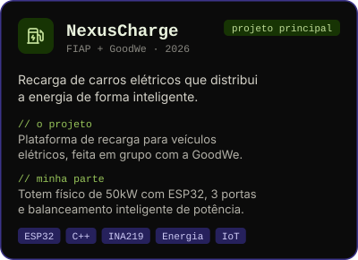

<p align="center">
  <a href="https://gustavozibini.github.io" title="Entrar na versão interativa do perfil">
    
  </a>
</p>

<p align="center">
  <code>12+ anos em suporte de TI</code> → <code>Ciência da Computação @ FIAP</code> → <code>IoT + nuvem</code> → <code>IA agêntica</code>
</p>

<h3 align="center"><code>// rede neural em treinamento</code></h3>

<p align="center">
  <a href="https://gustavozibini.github.io/#rede" title="Passe o mouse em cada fase na versão interativa">
    
  </a>
</p>

<h3 align="center"><code>// projetos em destaque</code></h3>

<p align="center">
  <a href="https://gustavozibini.github.io/#projetos" title="NOXUS · elevadores que sentem · OTIS Challenge 2025">
    
  </a>
  <a href="https://gustavozibini.github.io/#projetos" title="NexusCharge · recarga inteligente de carros elétricos · FIAP + GoodWe">
    
  </a>
</p>

<details>
<summary><b>💜 pílula roxa</b> · quem sou eu, em poucas linhas</summary>
<br>

```python
class Gustavo:
    base        = "12+ anos em suporte de TI (e contando)"
    formacao    = ["Sistemas de Informação · 2022", "Ciência da Computação @ FIAP"]
    construindo = ["NOXUS · IoT + Azure", "NexusCharge · ESP32 + energia"]
    rumo        = "IA agêntica: agentes que entendem, decidem e agem"
```

</details>

<details>
<summary><b>💚 pílula verde</b> · 13 certificados + 2 em treinamento</summary>
<br>

**IA generativa + agentes**
- Introduction to Agent Skills · Anthropic · 2026
- Claude 101 · Anthropic · 2026
- Capacita+: Construa com o Gemini · Google · 2026

**Fundamentos de IA**
- Inteligência Artificial de A a Z · EBAC · 2024
- Inteligência Artificial e Computacional · FIAP · 2024
- Fundamentos de IA: sistemas inteligentes · Alura · 2025
- Introdução à Inteligência Artificial · LinkedIn · 2025

**Python + dados**
- Python Development · FIAP · 2025
- Python para Data Science · Alura · 2025
- Databricks e Snowflake (fundamentos) · em treinamento

**Segurança da informação**
- Gestão de Riscos e Vulnerabilidades · FIAP · 2025
- Introdução à ISO 27000 · LinkedIn · 2025

**Tecnologia e sociedade**
- Soluções Tecnológicas Emergentes · FIAP · 2024
- Formação Social e Sustentabilidade · FIAP · 2025

</details>

<h3 align="center"><code>// stack</code></h3>

<p align="center">
  
</p>
<p align="center">
  <code>ESP32</code> <code>MQTT</code> <code>IoT</code> <code>Claude</code> <code>Gemini</code> <code>agentes de IA</code>
</p>

<h3 align="center"><code>// atividade</code></h3>

<p align="center">
  
</p>

<h3 align="center"><code>// contato</code></h3>

<p align="center">
  <a href="mailto:gustavo_belizario@hotmail.com" title="Mandar um e-mail para o Gustavo">
    
  </a>
  &nbsp;
  <a href="https://www.linkedin.com/in/gustavozibini/" title="Ver o perfil do Gustavo no LinkedIn">
    
  </a>
</p>

<p align="center">
  <sub><code>dica: clique no banner ou na rede neural para explorar a versão interativa</code></sub>
</p>
